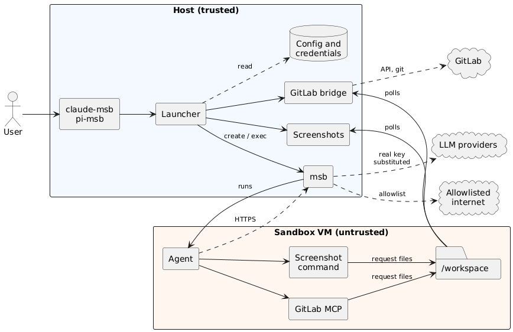

# Microsandbox Wrappers for AI Tools

This repository provides some wrappers that launch AI tools inside sandboxes to increase their safety,
including:

- Claude Code
- [Pi](https://pi.dev)

These tools are best run within sandboxes, however doing so can be
inconvenient and introduces many limitations and challenges. For example:

- the AI tools need secrets but if you put the secret in the sandbox it defeats the 
  purpose of the sandbox
- the sandbox needs to be able to see the content it is working on, and any related files,
  such as git repositories etc, while obscuring sensitive data.
- host-based functionality such as screenshots don't work inside the sandbox

These scripts facilitate some niceties including:

- auto-creation of sandbox with a simple model:
  - whatever folder you run it in becomes the only folder it can see, staged into the VM 
    under `/workspace`
  - smart setup to stage in Git repository config and files so 
    the AI model can see git and commit locally but not push commits anywhere
- setup of secrets / auth for Claude, OpenRouter, Bedrock / Anthropic (both short-lived)
  automatically with placeholders passed through to the AI models and 
  transparent substitution via TLS interception
- restricted network with auto-whitelist of common networking requirements so that
  sandboxes can install tools, language SDKs and other
  resources
- addition of live capture screenshot MCP tool to enable
  models to request and receive screenshots of a specified host
  window (fully controlled from host-side)
- GitLab access without credentials in the sandbox: the agent gets MCP
  tools bound to one issue and the current branch, and a host process
  does the work (see below)

These scripts utilise [Microsandbox](https://github.com/superradcompany/microsandbox) - a cross platform sandboxing tool 
that makes it convenient to manage sandboxes based on micro-VMs.  Because they use a full VM,
the contained agent has full admin / sudo access and can install and run tools such as docker and 
other platform / infrastructure requirements. The sandboxes are also persistent - so once an agent does 
do significant setup work, the sandbox can be saved and snapshotted so that it can start again without
redoing all that work.


## Install / setup

- Install Microsandbox from https://github.com/superradcompany/microsandbox
  - you may need to ensure you have sufficent Node version, see https://github.com/nvm-sh/nvm
- Clone the repository of [microsandbox-ai](https://github.com/ssadedin/microsandbox-ai) to an
  appropriate place on your computer
- Authenticate at least once directly on own computer using the method you intend to use within the sandbox, eg: run `claude` and then do `/login`.
  - Note: the launcher scripts piggyback from on your outside auth to bootstrap a token to use in the sandbox
- You can then run the tools using the launcher scripts in the `scripts` folder:

    ```
    bash /path/to/install/scripts/claude-msb.sh
    ```

## Architecture



Source: [architecture.puml](architecture.puml).

- **Trust boundary.** The sandbox is untrusted: anything the agent can write
  (the checkout, `.git`, the request files) is treated as hostile by the host
  helpers, which validate requests, never follow symlinks out of the request
  directory, and run git with hooks and the checkout's config disabled.
- **Credentials stay on the host.** Keys and tokens are resolved on the host and
  given to `msb` as secrets. The VM only holds placeholders, which `msb`'s TLS
  interception replaces on requests to the one allowed host.
- **No network path to the host helpers.** The agent talks to `gitlab_bridge.py`
  and `capture_screenshots.py` only through request files in the mounted
  workspace; each request names an operation, never a target.
- **Restricted network.** Outbound traffic is limited to an allowlist (see
  `msb-agent-lib.sh`, extended per repo in `.msb-agent/allowed-hosts`).

## Pi credentials

`pi-msb` resolves model credentials on the host, so the sandbox only ever holds
placeholders:

- **OpenRouter, OpenAI, Anthropic:** read from a host `pi` install if there is
  one (`pi auth print-api-key`). Without host pi these are skipped.
- **Amazon Bedrock:** a short-lived Bedrock API key is minted (the same
  mechanism `claude-msb` can use, see below) from a dedicated
  AWS profile named `pi-msb` in `~/.aws/credentials` or `~/.aws/config` (or the
  profile named by `PI_MSB_AWS_PROFILE`; `PI_MSB_AWS_REGION` defaults to
  `ap-southeast-2`). It needs `uv` on the host to sign the token. A dedicated,
  narrowly scoped profile is deliberate: the key carries that identity's
  permissions, so your admin profile is never used implicitly.

If neither works the launcher says why ("Bedrock: skipped: ..." before the
sandbox starts) and pi will ask you to log in inside the sandbox instead.

### Pi skills, extensions and prompts

Nothing from `~/.pi` is copied into the sandbox, because the agent directory
holds your credentials (`auth.json`, MCP tokens) and sessions. To make user
level resources available, mount them read-only (opt-in):

```
PI_MSB_MOUNT="skills extensions prompts" pi-msb
```

Only `skills`, `extensions`, `prompts` (prompt templates) and `themes` can be
named, taken from `~/.pi/agent` (or `PI_CODING_AGENT_DIR`). Edit them on the
host and run `/reload` in pi. Extensions run inside the sandbox with the
agent's privileges, so ones that rely on host-only tools or paths will not
work there. The mount rules and caveats (read-only enforcement, symlinks,
recreating the sandbox) are the same as for Claude, see "Editing skills on the
host" below.

## Claude credentials

`claude-msb` authenticates with your Claude subscription, using a long-lived
token from `claude setup-token`. The token stays on the host and is handed to
`msb` as a secret for `api.anthropic.com`, so the sandbox only ever sees a
placeholder that `msb` substitutes on requests to that host.

- **First launch:** with no stored token the launcher offers to run
  `claude setup-token` (needs `claude` on the host; it opens a browser) and
  asks you to paste the token it prints (`sk-ant-...`, input hidden). Without
  host `claude`, create one on any machine with `claude setup-token`.
- **Where it is kept:** the macOS Keychain (service `claude-msb`), or on other
  systems `~/.config/claude-msb/oauth-token` (mode 600). To replace it, delete
  that entry and launch again:
  `security delete-generic-password -s claude-msb` (macOS) or remove the file.
- **Overrides:** `CLAUDE_MSB_OAUTH_TOKEN` uses a token for one run without
  storing it. `CLAUDE_MSB_SECRET_OPTS` changes the `msb` secret options (see
  `msb_agent_add_secret`).
- **Not supported:** API keys and Console accounts. Claude uses either the
  subscription token or Bedrock (below).

### Claude on Amazon Bedrock

Set `CLAUDE_MSB_BEDROCK=1` to use Bedrock instead of a subscription. It works
like `pi-msb`: a short-lived Bedrock API key is minted on the host from a
dedicated AWS profile (`uv` on the host signs it) and handed to `msb` as a
secret, so the sandbox only holds a placeholder. No subscription token is
asked for.

```
CLAUDE_MSB_BEDROCK=1 claude-msb
```

- **Profile and region:** `CLAUDE_MSB_AWS_PROFILE` (default: `PI_MSB_AWS_PROFILE`,
  else `pi-msb`, so an existing `pi-msb` profile works as is) and
  `CLAUDE_MSB_AWS_REGION` (default `ap-southeast-2`). The key expires after
  `CLAUDE_MSB_BEDROCK_TOKEN_EXPIRY` seconds (default 43200, the maximum).
- **Models:** Claude's built-in model IDs are for other regions, so the
  launcher sets `ANTHROPIC_MODEL` to `CLAUDE_MSB_BEDROCK_MODEL` (default
  `au.anthropic.claude-opus-5-5`; set it to an empty string to leave Claude's
  default). Background tasks use the main model unless
  `CLAUDE_MSB_BEDROCK_SMALL_MODEL` is set. `ANTHROPIC_DEFAULT_OPUS_MODEL`,
  `ANTHROPIC_DEFAULT_SONNET_MODEL`, `ANTHROPIC_DEFAULT_HAIKU_MODEL` and
  `ANTHROPIC_BEDROCK_REGION_PREFIX` are passed through from your environment,
  which you need for `/model` choices other than the main model.
- **Separate sandbox:** Bedrock mode uses its own sandbox (`claude-bedrock-<project>`)
  so subscription and Bedrock secrets never mix; installed packages are not
  shared between the two.
- **Network:** the key is substituted only on requests to
  `bedrock-runtime.<region>.amazonaws.com` and `bedrock.<region>.amazonaws.com`
  (Claude uses the latter for model checks), and both hosts are allowed.

Other behavior worth knowing: permission prompts are skipped
(`--dangerously-skip-permissions`; set `CLAUDE_MSB_SKIP_PERMISSIONS=0` to keep
them), telemetry and error reporting are disabled, and on each launch your
`~/.claude` `CLAUDE.md`, `settings.json`, `skills`, `agents`, `commands` and
`output-styles` are copied into the sandbox (`CLAUDE_MSB_SYNC` changes the
list). From `settings.json`, entries that run host commands (`hooks`,
`statusLine`, `apiKeyHelper`, ...) are dropped, and the file is not copied at
all if `jq` is missing on the host. Credentials, history and plugins are
never copied. The copy is redone on every launch, so host edits apply from the
next launch, files you delete on the host stay in the sandbox, and files that
exist on the host overwrite the sandbox's copy.

### Editing skills on the host: read-only mounts

To see host edits immediately, mount those directories read-only instead of
copying them (opt-in):

```
CLAUDE_MSB_MOUNT="skills agents commands" claude-msb
```

Only `skills`, `agents`, `commands` and `output-styles` can be named; they are
mounted from `~/.claude` and are no longer copied. Pi has the same option, see
"Pi skills, extensions and prompts" above.

- **Read-only is enforced by `msb` on the host**, so even root in the sandbox
  cannot change your files, and the agent cannot plant a skill that later runs
  or steers a session on your host. The agent can read what is in those
  directories (as it can with the copy), so keep secrets out of them.
- **Symlinks that leave the directory do not work.** `msb` blocks symlinks that
  point outside a mounted directory, so a skill that is a symlink to a shared
  skills repo is dangling in the sandbox. The launcher warns about these;
  keep that entry on the copy (the copy follows symlinks) or mount the real
  location.
- **Mounts are fixed when the sandbox is created.** Changing
  `CLAUDE_MSB_MOUNT` (or `PI_MSB_MOUNT`) for an existing sandbox is refused
  with a `msb rm <sandbox>` hint, in either direction. A real `~/.claude/skills`
  directory already inside the sandbox is left alone, with a warning.
- A running session may only pick up edits when it rescans, so start a new
  session after changing skills.

## Behind a TLS-intercepting network

If your network re-signs HTTPS with a company root (Zscaler and similar),
install that root on the host the normal way (device management, so it is in
the OS trust store). Then:

- **Inside the sandbox** this is already handled: sandboxes are created with
  `--trust-host-cas`, and the sandbox's proxy checks upstream certificates
  against the host's root store.
- **The base image pull** is done by `msb` on the host and needs the root in
  msb's own config: set `registries.ca_certs` in `~/.microsandbox/config.json`
  (see the microsandbox docs, "Configure company networking"). A cached image
  is not affected.
- **`uv` on the host** (screenshots, pi's Bedrock login) does not use the OS
  store by default; export `UV_NATIVE_TLS=1` or `SSL_CERT_FILE=<bundle>`.
- **The GitLab bridge** keeps `GIT_SSL_CAINFO`, `SSL_CERT_FILE`,
  `SSL_CERT_DIR` and the usual proxy variables (`HTTPS_PROXY`, `NO_PROXY`, ...)
  from your environment for its git calls, and your global git config is not
  read. For an intercepted GitLab host set `ca_file` on the instance (or export
  `SSL_CERT_FILE`) to a bundle containing the company root *and* the public
  roots: `ca_file` replaces the default trust, it does not add to it. On macOS:

  ```
  security find-certificate -a -p \
      /Library/Keychains/System.keychain \
      /System/Library/Keychains/SystemRootCertificates.keychain \
      > ~/.config/msb-agent/ca-bundle.pem
  ```

  An internal GitLab that the proxy does not inspect needs none of this.

## Launching inside a submodule

Running a wrapper from inside a submodule scopes the agent to that source
tree. A submodule's `.git` is a pointer into the superproject, so the sandbox
mounts just two things, keeping their positions below their nearest common
parent directory so every relative pointer (including nested submodules')
still resolves:

```
<superproject>/libs/a                -> /workspace/libs/a                  (working directory)
<superproject>/.git/modules/libs/a   -> /workspace/.git/modules/libs/a
```

The rest of the superproject is not visible. This also covers a superproject
that is a linked worktree. The layout is fixed when the sandbox is created
(recorded in the `msb-agent-layout` label), so a sandbox made for another
layout is refused with a hint to `msb rm` it.

## GitLab integration

```
claude-msb --gitlab-issue 32          # or group/project#32, or an issue URL
pi-msb --gitlab-issue 32 --branch 32-reset-cache-dump
```

then prompt "Work on issue 32". The agent gets MCP tools (server
`msb-gitlab`) to read the issue, comment on it, see where its work stands,
submit merge requests, and read and comment on them. None takes a ticket,
project or branch argument, so the agent can only act on the issue you named
and one branch name; a repo is chosen only from the list built at startup. A
host process does the work, so the sandbox holds no GitLab credentials.

Images uploaded to the issue (screenshots in its description or comments)
are listed by `gitlab_get_issue` and fetched by number with
`gitlab_get_attachment`, which returns the image and saves a copy under
`.<tool>/gitlab-requests/attachments/`. On each request the bridge rereads the
issue and fetches only an upload its text references, from the issue's own
project, through the uploads API (GitLab 17.4 or later). Links to other
projects' uploads or to other sites are listed but never fetched, and only
PNG, JPEG, GIF and WebP files up to 5 MB are returned.

### Submodules

The work can span the checkout and its (nested) submodules, all on the same
branch name, which is `--branch`, else the branch the checkout is already on,
else `<issue>-<title slug>` (`32-reset-cache-dump`). Before the sandbox
starts, the launcher creates that branch in each repo and, when the agent
ends, removes the ones that were never used and puts everything back as it
was. Only repos that end up with commits get a remote branch and a merge
request, and `gitlab_submit_merge_requests` handles all of them in one call.
Merge requests link to the issue ("Related to"), to each other, and, where
the agent reports a real functional dependency, "Requires <MR>: <reason>".

Commits that change a submodule pointer are refused: pointers are updated
after merge, not in merge requests.

How each repo is prepared at launch:

| State of the repo | What happens |
|---|---|
| on its default branch | branch from there |
| already on the session branch | continue |
| detached on the commit its parent records, project in `working_set` | fetch, check out and fast-forward the default branch, branch from it |
| detached on the commit its parent records, not in `working_set` | skipped silently |
| anything else (other branch, detached elsewhere, uncommitted changes, local default branch ahead of origin, odd git config) | you are asked: check out and pull, skip, skip and don't ask again, or abort |

Without a terminal the launcher aborts on that last case; add
`--gitlab-skip-unprepared` to skip those repos instead. The fetch uses the
group token over HTTPS, never your SSH keys or the repo's own remote
configuration.

### Configuration

Instance, token and project mapping live on the host in
`~/.config/msb-agent/gitlab.json`, which the sandbox cannot see:

```json
{
  "instances": {
    "git.example.com": {
      "url": "https://git.example.com",
      "token_file": "~/.config/msb-agent/example.token",
      "ca_file": "/path/to/ca-bundle.pem"
    }
  },
  "repos": {
    "/path/to/checkout": {
      "instance": "git.example.com",
      "project": "group/app",
      "issue_project": "group/tracker",
      "working_set": ["group/ui-*", "group/api"],
      "submodules": {"libs/odd": "group/odd-name"}
    }
  }
}
```

- `token_file` (mode 600), `token_env` or `token_keychain` (macOS) supply the
  token. It needs the `api` and `write_repository` scopes and must reach every
  project involved, so use a group access token (Developer role) or a personal
  token. `url` defaults to `https://<instance name>`; `ca_file` is a
  complete CA bundle for internal or intercepted hosts (see above). Everything is assumed to live on one instance.
- `repos` is optional. An entry is keyed either by **project path** (or a glob)
  or by **checkout path**:
  - A project key such as `group/app` or `group/*` matches the project the
    checkout's `origin` remote points at, so the same config works on every
    machine and is the right choice for a file you share. An exact key beats a
    glob.
  - A key that starts with `/`, `~` or `.`, or contains `$VAR`, is a checkout
    path (`~` and variables are expanded). It matches that checkout or, for a
    linked worktree, its primary checkout, and wins over a project key.

  Without an entry the project comes from the `origin` remote (whose host must
  be a configured instance, which is also how the instance is chosen) and
  issues are looked up in the same project. `instance` and `project` inside an
  entry are only needed to override that. Submodule projects are worked out
  from their URLs (relative ones such as `../x.git` resolve against the
  parent's remote); `submodules` overrides that per path.
- `working_set` lists the projects (globs allowed) that are checked out to
  their default branch automatically when a submodule is detached, as after a
  fresh clone or in a new worktree. Without it, detached submodules are
  skipped. "Skip and don't ask again" answers are remembered in
  `~/.local/state/msb-agent/gitlab/`.

A submodule that cannot be prepared never blocks the session: if its GitLab
project cannot be found (for example a `.wiki` submodule or a stale URL), or
anything else goes wrong with it, the launcher prints a warning, leaves the repo
as it was and skips it. A clean submodule detached on its recorded commit that is
outside the `working_set` is skipped without asking GitLab anything, so it does
not need a valid project at all. Only a failure in the checkout itself is fatal.

Only submodules that are initialised at launch take part. Pushes are never
forced and never target a default or protected branch.

Example working configuration for VCGS repositories / projects. It uses no
machine-specific paths, so it can be shared as is (each person sets
`GITLAB_TOKEN`). Both `giphub` and `webservices` (launched on its own, as a
submodule) match the one `VCGS/CBU/*` entry:

```json
{
  "instances": {
    "git.vcgs.org.au": {
      "url": "https://git.vcgs.org.au",
      "token_env": "GITLAB_TOKEN"
    }
  },
  "repos": {
    "VCGS/CBU/*": {
      "issue_project": "VCGS/CBU/clinicalbioinformatics",
      "working_set" : [ "webservices", "gip", "webservices/ghm" ]
    }
  }
}
```
